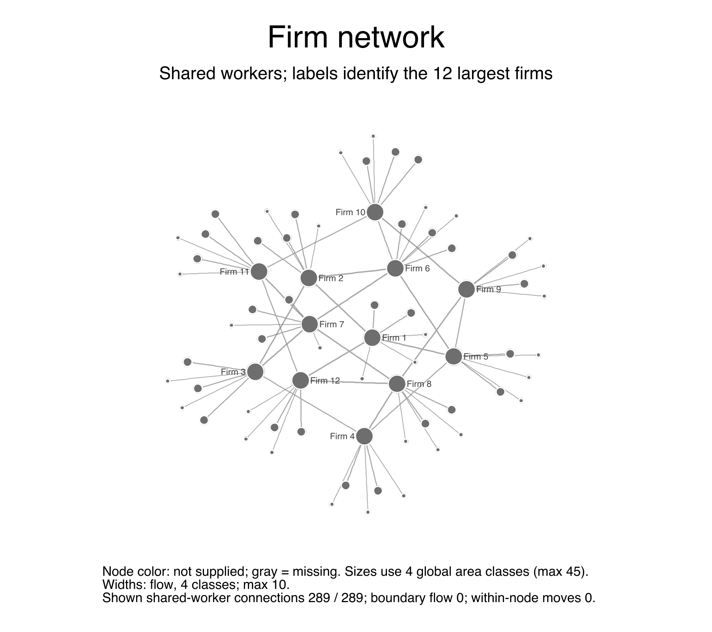
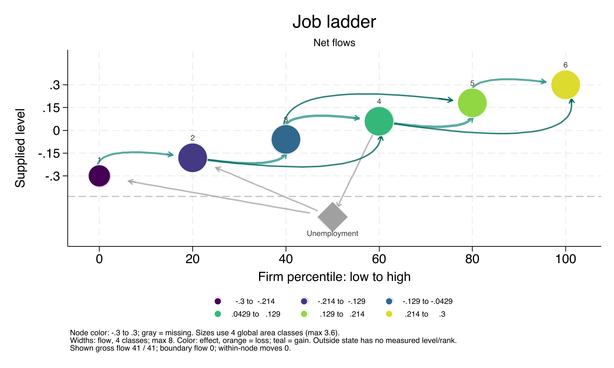

# fegraph

`fegraph` draws firm networks, worker–firm match graphs, job ladders, flow
heatmaps and mover event studies from linked employer–employee data in Stata.
It creates ordinary Stata graphs and optional standalone HTML animations.

Supply firm wage effects, ranks or other scores from your own data, or from
[fe-tools](https://github.com/topics/fe-tools) companions such as
[fereg](https://github.com/johannes-schmieder/fereg),
[ferank](https://github.com/johannes-schmieder/ferank) and
[fesim](https://github.com/johannes-schmieder/fesim).
The graph command does not estimate these attributes or require those packages.

| Firm network | Job ladder |
| --- | --- |
|  |  |

## Requirements

- Stata 16 or newer syntax; tested on **macOS Stata/MP 19**.
  Other Stata versions and operating systems have not been qualified.
- A modern browser for optional HTML playback. The HTML embeds its data and
  viewer: no internet connection, JavaScript library, server or Python is needed.
- Optional DGP reports require Stata 19 and the companion packages listed
  [below](#simulation-reports).

Version **0.7.0**. See [validation](docs/validation.md) for tested behavior and limits.

## Installation

Run in Stata:

```stata
net install fegraph, replace ///
    from("https://raw.githubusercontent.com/johannes-schmieder/fegraph/main/")

fegraph, selftest
help fegraph
```

Restart Stata after updating a loaded version. The installation includes the
command, help, example runner and both HTML viewers. See
[installation notes](INSTALLATION.md) for local installation and troubleshooting.

## Try a complete example

These examples generate their own data and restore your data and estimation
results afterward:

```stata
* A firm network with thin links and larger hubs
fegraph_run classic using fegraph.sthlp

* A job ladder with unemployment
fegraph_run ladder using fegraph.sthlp

* Mover wage profiles, including a standalone HTML animation
fegraph_run eventstudy using fegraph.sthlp
```

The help contains **18 runnable examples**, including coworker-wage quartiles,
color palettes and simulated DGP reports. HTML and other saved example outputs
go into `fegraph_examples/` in Stata's current working directory.
See the [example index](examples/README.md).

## Use your own panel

The variable before the comma is the optional **firm score**.
Identify workers and firms explicitly with `worker()` and `firm()`.

```stata
* Directed net worker flows; color firms by their supplied wage effect
fegraph psi_hat, worker(workerid) firm(firmid) time(year) ///
    type(firmgraph) net style(classic)

* Deciles of the firm score, with net flows between them
fegraph psi_hat, worker(workerid) firm(firmid) time(year) ///
    type(ladder) bins(10) net top(30)

* Destination shares between firm-score quartiles
fegraph psi_hat, worker(workerid) firm(firmid) time(year) ///
    type(heatmap) bins(4) statistic(share)

* Worker–firm matches; start with a small selected sample
fegraph if workerid <= 20, worker(workerid) firm(firmid) type(bipartite)

* Mean log wages around employer changes, grouped by firm-score quartile
fegraph psi_hat, worker(workerid) firm(firmid) time(year) ///
    type(eventstudy) wage(lnwage) wagescale(log) ///
    bins(4) window(-2 1) ci
```

`bins()` forms score quantiles with one observation per selected firm by default;
ties stay together. Firm scores must be constant within firm. Mover profiles
also accept `group()` for prepared, potentially time-varying coworker groups.

Directed flows require unique worker–time observations. Missing employers break
chains; use `nonemployment(indicator)` for an explicitly observed outside state.
Mover profiles require balanced windows and are descriptive, not causal estimates.

## HTML animations and graph export

Add `animation(filename.html, options)` to any of the five views:

```stata
fegraph psi_hat, worker(workerid) firm(firmid) time(year) ///
    type(ladder) bins(10) palette(blues) ///
    animation("ladder.html", mode(time) replace)

graph export "ladder.pdf", replace
graph export "ladder.png", width(2000) replace
```

Default HTML playback animates the aggregate graph. `mode(time)` replays observed
periods; for mover profiles it compares arrival cohorts. Controls include
play/pause, stepping, scrubbing, speed and light/dark themes. Download the HTML
and open it in a browser if an in-app file preview shows a blank graph.

Use `graphopts(title("") subtitle("") note(""))` to suppress native annotations.
HTML annotations have their own nested options, such as
`animation("graph.html", notitle nosubtitle nonotes replace)`.
The [usage guide](docs/usage.md) covers palettes, flow definitions, prepared
edge lists, sample selection, audit tables and further examples.

## Simulation reports

With `fesim`, `fereg`, `ferank`, `latexlog` and `texpdf` installed:

```stata
fegraph_run report_all using fegraph.sthlp
```

This produces a PDF for AKM, job-ladder and Burdett–Mortensen simulations, with
nine figures per DGP and companion mover-profile HTML files. It uses 6,000
workers, 80 firms and 12 annual observations per DGP. The job-ladder example is
AKM with `network(ladder)`; the BM example is the separate wage-posting model.
See [report requirements and output paths](examples/README.md#simulation-reports).

## Documentation

- [Installation and updates](INSTALLATION.md)
- [Usage guide](docs/usage.md)
- [Stata help and full syntax](stata/fegraph.sthlp)
- [Runnable examples](examples/README.md)
- [Validation and support limits](docs/validation.md)
- [Changelog](CHANGELOG.md)
- [Contributing and tests](CONTRIBUTING.md)

## Author and feedback

Johannes F. Schmieder. Please report bugs with a small reproducible example in
[GitHub Issues](https://github.com/johannes-schmieder/fegraph/issues).
